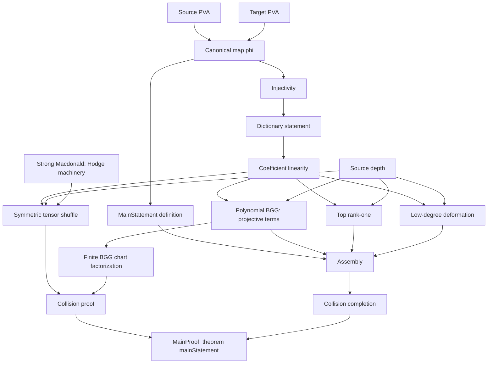

# Pure SU(2) PVA in Lean

A Lean 4 formalization of Theorem 1.1 of A. Z. Khan,
[*Lie Algebra Cohomology and Seiberg-Witten Theory*](paper/Pure_SU2_PVA_Proof.pdf).
The theorem: the canonical map `phi` from the differential Poisson vertex superalgebra with
generators X, Y and relations X² = XY = X∂Y = Y∂Y = 0 to the relative Lie algebra cohomology
H\*(sl₂[x,y]/(y²), sl₂) is an isomorphism of graded differential Poisson vertex superalgebras.

```lean
theorem KhanSL2.mainStatement : KhanSL2.MainStatement
```

`MainStatement` ([MainStatement.lean](lean/KhanSL2/MainStatement.lean)) says that `phi` is
bijective and preserves the unit, product, translation, λ-bracket and grading.
[Final.lean](lean/Final.lean) restates it with the source, target and map written out. The
proof depends on `propext`, `Classical.choice` and `Quot.sound` only.

The development also proves the sl₂ case of Theorem B of Fishel–Grojnowski–Teleman, in its
invariant-theoretic form: the harmonic invariants are the free supercommutative algebra on the
stated even and odd generators
([`StrongMacdonald.harm_free`](lean/KhanSL2/StrongMacdonald/SliceRing.lean)), and in each
bidegree they are isomorphic to cohomology
([`StrongMacdonald.harmEquivCohom`](lean/KhanSL2/StrongMacdonald/Hodge.lean)).

Size: about 121,000 lines in 1,049 Lean files, counting comments and audit files, on top of
mathlib and Tau Ceti.

## Build

Lean 4.36.0-rc1 is pinned in `lean/lean-toolchain`; mathlib and Tau Ceti are pinned in
`lean/lake-manifest.json`. The first build downloads them.

```sh
cd lean
lake exe cache get
lake build FinalAudit      # the main theorem and its axiom check
```

The full check, from the repository root, is `bash scripts/verify.sh` (Linux/macOS, needs
Python 3) or `.\verify.ps1 -Serial` (Windows PowerShell). It checks the Lean sources against the
hashes in `verification/`, builds every default target and re-runs the 20 audit files.

In VS Code, open [sl2-vfinal.code-workspace](sl2-vfinal.code-workspace) or the `lean/` folder.

## Check the theorem

In a scratch file under `lean/`:

```lean
import Final

#check KhanSL2.mainStatement_explicit
#print axioms KhanSL2.mainStatement
-- 'KhanSL2.mainStatement' depends on axioms: [propext, Classical.choice, Quot.sound]
```

`MainStatement` is the proposition and `mainStatement` is its proof.

## What is trusted

- Lean's kernel and the three standard axioms. `MainProofAudit.lean` fails if any project
  declaration in the theorem's import closure depends on another axiom or on `sorryAx`.
- The definitions of the source, the target and `phi`. Lean checks the proposition as written;
  whether it matches the paper is a question about those definitions.
  [SCOPE.md](docs/SCOPE.md) lists the conventions needed to compare them: finite-mode cochains,
  the degree convention, the color basis and one sign that differs from the manuscript.
- mathlib and Tau Ceti at the pinned revisions.

`verification/` also holds a frozen copy of the statement and a script that compares it with
`lean/` using Lean's comparator. That comparison has not been run; see
[verification/STATUS.md](verification/STATUS.md).

## Module graph

The modules reachable from `MainProof` number 967, with 1,738 direct imports. The graph below
keeps 18 of them and removes redundant arrows. An arrow points from a module to one that uses
it, possibly through intermediate files. mathlib and Tau Ceti are omitted. It shows imports,
not theorem dependencies; [PROOF-GUIDE.md](docs/PROOF-GUIDE.md) explains the proof.



## Layout

| Path | What it is |
|---|---|
| `lean/Final.lean` | The main theorem with source, target, operations and map written out |
| `lean/MainProof.lean` | `mainStatement` and `phi_bijective` |
| `lean/KhanSL2/` | Definitions and proofs, by topic |
| `lean/*Audit.lean` | Axiom and type checks |
| `docs/SCOPE.md` | The theorem in mathematical language; conventions; what is not formalized |
| `docs/DECLARATIONS.md` | Objects and claims of the paper, mapped to Lean declarations |
| `docs/PROOF-GUIDE.md` | The structure of the proof |
| `formalization.json` | Machine-readable index of the main declarations |
| `verification/` | Source hashes, frozen statement, build logs, last results |
| `scripts/` | Verification, integrity and comparison scripts |
| `paper/` | The manuscript |
